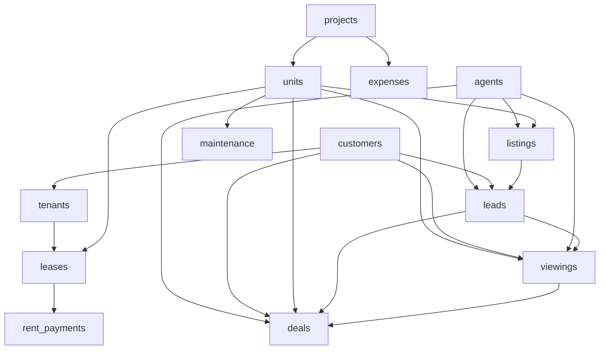

# Real Estate Intelligence & AI Decision Engine — Business Data Map

## 1. Executive Summary & Business Architecture

This document formalizes the domain entities, relational topology, business metrics, and machine learning problem mapping for the Real Estate Intelligence platform. The ecosystem spans three operational business models:
1. **Real Estate Development:** Project planning, unit construction, capital expenditure, and asset valuation.
2. **Real Estate Brokerage:** Multi-channel lead acquisition, property listings, sales agent management, viewings, and deal closings.
3. **Property & Facility Management:** Tenant screening, lease contracts, recurring rent collections, and ongoing asset maintenance.

---

## 2. Business Entity Relationship Map



### Verified Relational Connections (100% Referential Match)
* `projects` (1) ───< `units` (N) via `project_id`
* `projects` (1) ───< `expenses` (N) via `project_id`
* `units` (1) ───< `listings` (N) via `unit_id`
* `agents` (1) ───< `listings` (N) via `agent_id`
* `listings` (1) ───< `leads` (N) via `listing_id`
* `customers` (1) ───< `leads` (N) via `customer_id`
* `agents` (1) ───< `leads` (N) via `agent_id`
* `leads` (1) ───< `viewings` (N) via `lead_id`
* `units` (1) ───< `viewings` (N) via `unit_id`
* `customers` (1) ───< `viewings` (N) via `customer_id`
* `agents` (1) ───< `viewings` (N) via `agent_id`
* `viewings` (1) ───< `deals` (N) via `viewing_id`
* `leads` (1) ───< `deals` (N) via `lead_id`
* `units` (1) ───< `deals` (N) via `unit_id`
* `customers` (1) ───< `deals` (N) via `customer_id`
* `agents` (1) ───< `deals` (N) via `agent_id`
* `customers` (1) ───< `tenants` (N) via `customer_id`
* `units` (1) ───< `leases` (N) via `unit_id`
* `tenants` (1) ───< `leases` (N) via `tenant_id`
* `leases` (1) ───< `rent_payments` (N) via `lease_id`
* `units` (1) ───< `maintenance` (N) via `unit_id`

---

## 3. Business Role of Each Table

### 1. `projects`
* **Business Entity:** Master development projects and compounds.
* **Information Contained:** Developer identity, project type, regional location, launch/completion dates, and popularity score.
* **Analytics/ML Utility:** Serves as high-level macro grouping for location pricing trends, developer prestige scoring, and project-level ROI analysis.

### 2. `units`
* **Business Entity:** Individual physical real-estate units belonging to projects.
* **Information Contained:** Architectural specifications (area, bedrooms, floor), finishing tier, construction year, base price, and rental valuation.
* **Analytics/ML Utility:** Core feature matrix for property valuation models, price-per-sqm estimation, and rental yield forecasting.

### 3. `customers`
* **Business Entity:** Prospective buyers, tenants, investors, and corporate clients.
* **Information Contained:** Contact profiles, customer type (Investor/End User/Business/Landlord), preferred locations, property preferences, and budget ranges.
* **Analytics/ML Utility:** Primary entity for behavioral customer segmentation, buyer persona clustering, and lead-to-buyer compatibility scoring.

### 4. `agents`
* **Business Entity:** Sales brokers and real estate agents.
* **Information Contained:** Team affiliations, property specializations, geographic coverage, experience years, and historical effectiveness ratings.
* **Analytics/ML Utility:** Enables agent performance scoring, commission analytics, and conversion propensity adjustment based on agent competence.

### 5. `listings`
* **Business Entity:** Market listing records for unit sale or rental availability.
* **Information Contained:** Listed prices, publication dates, listing types (Sale/Rent), days on market, market views, and inquiry volumes.
* **Analytics/ML Utility:** Provides market liquidity indicators, price elasticity analysis, and days-on-market survival forecasting.

### 6. `leads`
* **Business Entity:** Top-of-funnel customer inquiries and marketing prospects.
* **Information Contained:** Acquisition channel (Facebook, Website, Referral, etc.), inquiry timestamps, predictive lead score, and interaction frequency.
* **Analytics/ML Utility:** Core table for lead conversion prediction, marketing channel attribution, and funnel drop-off analytics.

### 7. `viewings`
* **Business Entity:** Physical and virtual property inspection appointments.
* **Information Contained:** Viewing dates, format (Physical/Virtual), appointment status (Interested/Considering/Not Interested/No Show), and client feedback ratings.
* **Analytics/ML Utility:** Critical intermediate funnel signal for deal conversion probability, customer intent classification, and qualitative feedback evaluation.

### 8. `deals`
* **Business Entity:** Finalized or cancelled sales and rental transaction contracts.
* **Information Contained:** Final negotiated price, deal outcome status (Closed/Cancelled), transaction date, payment method, and broker commissions.
* **Analytics/ML Utility:** Ground-truth target variable for sales conversion modeling, revenue realization analytics, and pricing discount estimation.

### 9. `expenses`
* **Business Entity:** Project-level operational, administrative, legal, and marketing expenditures.
* **Information Contained:** Expense category, expenditure date, financial amount in EGP, description, and controlled anomaly indicators.
* **Analytics/ML Utility:** Baseline data for net margin calculation, financial budgeting, cost forecasting, and financial anomaly detection.

### 10. `tenants`
* **Business Entity:** Verified occupants of leased properties.
* **Information Contained:** Tenant classification (Individual/Family/Business), credit score ratings, contact details, and initial registration dates.
* **Analytics/ML Utility:** Key data source for tenant risk profiling, lease default prediction, and occupancy stability analysis.

### 11. `leases`
* **Business Entity:** Legal rental contracts between property management and tenants.
* **Information Contained:** Lease start/end dates, agreed monthly rent, security deposits, and contract lifecycle status (Active/Expired/Terminated).
* **Analytics/ML Utility:** Fundamental basis for monthly recurring revenue (MRR) projection, occupancy rate modeling, and tenant churn analysis.

### 12. `rent_payments`
* **Business Entity:** Individual monthly rent collection transactions.
* **Information Contained:** Scheduled due date, actual payment date, amount due vs paid, payment method, and payment status (Paid/Late/Partial).
* **Analytics/ML Utility:** Crucial for cash-flow forecasting, payment delay anomaly detection, and delinquency risk modeling.

### 13. `maintenance`
* **Business Entity:** Maintenance, repair, and facility service tickets for physical units.
* **Information Contained:** Service category (Plumbing, Electrical, HVAC, etc.), request/completion timelines, urgency level, and incurred cost in EGP.
* **Analytics/ML Utility:** Key dataset for property operating expense (OpEx) forecasting, asset depreciation analysis, and repair cost anomaly detection.

---

## 4. ML Problem Mapping

The tabular data supports five primary machine learning tracks:

```text
┌──────────────────────────────────────┬────────────────────────────────────────────────────┐
│ ML Problem                           │ Primary Source Tables                              │
├──────────────────────────────────────┼────────────────────────────────────────────────────┤
│ 1. Property Price Prediction         │ units, projects                                    │
│ 2. Lead Conversion Prediction        │ leads, customers, listings, viewings, deals        │
│ 3. Customer Segmentation             │ customers, deals, viewings                         │
│ 4. Revenue & Cash-Flow Forecasting   │ deals, expenses, rent_payments, leases             │
│ 5. Anomaly Detection                 │ expenses, maintenance, rent_payments               │
└──────────────────────────────────────┴────────────────────────────────────────────────────┘
```

> **Note:** The listed tables serve as the **primary feature source**. Additional tables will be joined during Phase 3 (Feature Engineering) whenever logically and mathematically justified.

---

## 5. Definition of Core Business Metrics

1. **Revenue:** Total gross financial inflow recognized from closed property sales and collected rental payments.
2. **Costs:** Total aggregate financial outflow comprising project operational expenses, marketing spend, salaries, commissions, and maintenance costs.
3. **Gross Profit:** Total revenue minus direct cost of goods/services before indirect administrative overhead.
4. **Net Profit:** Total revenue minus all incurred operating expenses, financial costs, and project outlays (`Revenue - Costs`).
5. **Profit Margin:** Percentage ratio of net profit to total revenue (`(Net Profit / Revenue) * 100`).
6. **Deals Count:** Total volume of completed purchase or lease contracts successfully executed within a given time window.
7. **Conversion Rate:** Percentage of top-of-funnel leads that ultimately progress to closed transactions (`(Closed Deals / Total Leads) * 100`).
8. **Average Deal Value (ADV):** Mean financial transaction value across all closed property sales (`Total Closed Sales Revenue / Closed Deals Count`).
9. **Occupancy Rate:** Percentage of rentable property units currently under active, non-expired lease contracts (`Active Leased Units / Total Rentable Units`).
10. **Rental Revenue:** Aggregate recurring income collected specifically from active residential and commercial lease agreements.
11. **Customer Value (LTV):** Cumulative gross transaction volume and recurring rental yield generated by an individual customer across their lifecycle.
12. **Agent Performance:** Multi-dimensional rating reflecting closed sales volume, conversion efficiency, and customer satisfaction score for an individual broker.

---

## 6. Business Story & Analytical Principles

This enterprise intelligence system captures the full operational lifecycle of a modern real estate conglomerate spanning **Development**, **Brokerage**, and **Property Management**.

To ensure rigorous data science and business governance, the following foundational principles apply throughout this initiative:

1. **$\text{Revenue} \ne \text{Profit}$:** High transaction volume does not imply business success if customer acquisition costs (CAC) or operational expenditures exceed gross earnings.
2. **$\text{Cost} \ne \text{Revenue}$:** High project construction or marketing expenditures do not guarantee market uptake or pricing power.
3. **$\text{Correlation} \ne \text{Causation}$:** Statistical co-occurrence between features (e.g., viewing feedback and deal closure) will not be treated as a causal driver of profitability without rigorous econometric validation and controlled experimentation.
